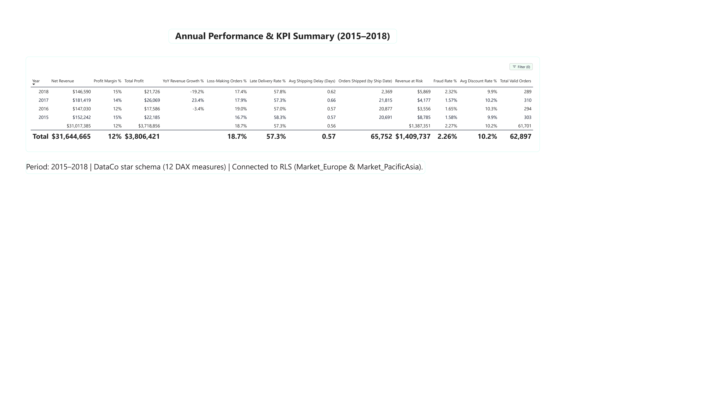

# DataCo Supply Chain Power BI Dashboard

Interactive Power BI dashboard and data model for the DataCo Supply Chain dataset (2015–2018), structured into a star schema with 12 DAX measures and Row-Level Security (RLS) to answer: how do revenue and profit perform across segments and categories, how is delivery SLA across markets and shipping modes, and where is order fraud/cancellation risk concentrated?

## Key findings
- **Commercial scale (2015–2018):** Total valid orders reach 62,897 with $31.64M in Net Revenue, $3.81M in Total Profit (12% profit margin), and 18.7% loss-making orders.
- **Customer & category mix:** Consumer is the largest segment at $16M (51.88%), followed by Corporate ($10M, 30.4%) and Home Office ($6M, 17.72%), with Fishing, Cleats, and Camping & Hiking leading category revenue.
- **Logistics SLA:** Overall Late Delivery Rate is 57.3% with an average shipping delay of 0.57 days across 65,752 shipped orders, staying consistently high across all five markets and noticeable across shipping modes.
- **Order risk & fraud:** Revenue at Risk totals $1.41M (2.26% fraud rate), driven by SUSPECTED_FRAUD and CANCELED orders, with higher risk concentration in Europe and LATAM and elevated rates on TRANSFER payments.

## Data
- **Source:** DataCo Smart Supply Chain Dataset (2015–2018), publicly available on Kaggle.
- **Licensing & availability:** Raw dataset files are not redistributed in this repository due to GitHub file size limits; see `Data/README.md` for dataset notes.

## What the model & report include
1. **Star schema modeling:** Separates order transaction facts from date, geography, customer, and product dimensions.
2. **12 DAX measures:** Covers commercial KPIs (`Net Revenue`, `Total Profit`, `Profit Margin %`, `YoY Revenue Growth %`, `Loss-Making Orders %`, `Avg Discount Rate %`, `Total Valid Orders`), logistics SLA (`Orders Shipped (by Ship Date)`, `Late Delivery Rate %`, `Avg Shipping Delay (Days)`), and risk (`Revenue at Risk`, `Fraud Rate %`).
3. **Row-Level Security (RLS):** Configured `Market_Europe` and `Market_PacificAsia` roles to restrict regional access (verified via `Market_Europe` view at $421K Revenue at Risk and 2.30% Fraud Rate).
4. **Four report pages:** Annual Performance & KPI Summary (2015–2018), Executive Commercial & Profit Overview, Supply Chain & Logistics SLA, and Order Risk & Fraud using a Clean Teal theme (`Segoe UI`).

## Dashboard previews

### Annual Performance & KPI Summary (2015–2018)

### Executive Commercial & Profit Overview

### Supply Chain & Logistics SLA

### Order Risk & Fraud

### Row-Level Security (`Market_Europe`)

## Limitations
- **Scope & filtering:** Metrics reflect the configured report logic, valid/shipped/risk order definitions, and 2015–2018 dataset coverage.
- **Observational data:** Patterns in late delivery, discounting, and fraud/cancellation risk show associations in the dataset rather than proven causation.
- **Regional access:** RLS previews demonstrate role filtering (`Market_Europe`) rather than live enterprise identity provider integration.

## Repository structure

├── Data/          # Dataset notes (README.md)
├── Images/        # Dashboard and RLS screenshots (.png)
├── Pbix/          # Power BI report file (.pbix)
├── LICENSE        # Repository license
└── README.md      # Project documentation

## Tools
Power BI Desktop · DAX · Star Schema · Row-Level Security

##Author
Nalendra Whisnu Pinilih · Information Systems, Universitas Dian Nuswantoro · GitHub
