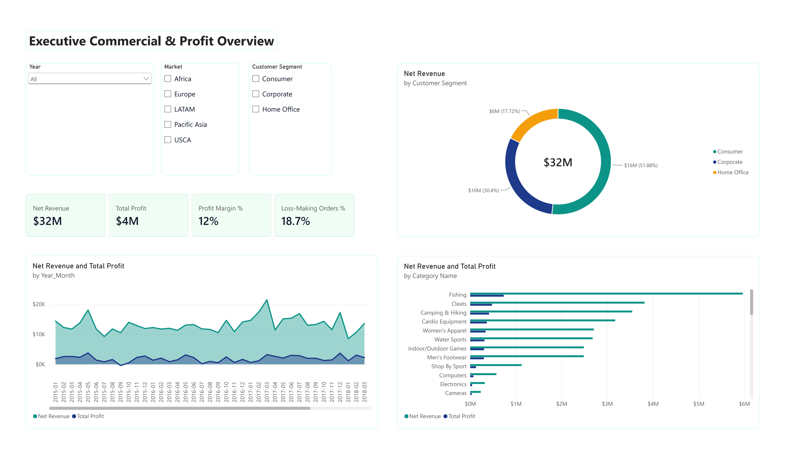
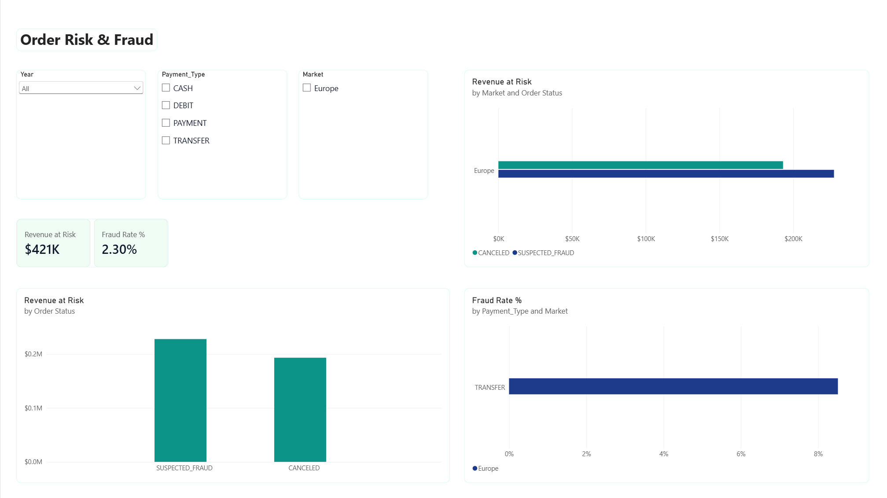

# DataCo Supply Chain Power BI Dashboard

End-to-end Power BI analytics solution built on the **DataCo Supply Chain** dataset (2015–2018), structured around a star schema (`Fact_Orders`, `Dim_Date`, `Dim_Geography`, `Dim_Customer`, `Dim_Product`) with **12 DAX measures**, a **Clean Teal** visual theme (`Segoe UI`), and **Row-Level Security (RLS)** (`Market_Europe` and `Market_PacificAsia`).

## Dashboard Pages & Previews

### 1. Annual Performance & KPI Summary (2015–2018)
Summarizes key commercial, logistics SLA, and risk metrics across 2015–2018 alongside total figures and scope/methodology notes.


### 2. Executive Commercial & Profit Overview
Tracks overall commercial scale and profitability across segments, time periods, and product categories (`$32M` Net Revenue, `$4M` Total Profit, `12%` Profit Margin, `18.7%` Loss-Making Orders).



### 3. Supply Chain & Logistics SLA
Monitors shipping performance across markets and shipping modes (`57.3%` Late Delivery Rate, `0.57` Avg Shipping Delay Days, `66K` Orders Shipped).


### 4. Order Risk & Fraud
Highlights financial exposure and fraud patterns across markets, order statuses (`SUSPECTED_FRAUD` and `CANCELED`), and payment methods (`$1M` Revenue at Risk, `2.26%` Fraud Rate).


## Row-Level Security (RLS)
Role-based access is configured for regional markets (`Market_Europe` and `Market_PacificAsia`). Below is a preview filtered under the `Market_Europe` role (`$421K` Revenue at Risk, `2.30%` Fraud Rate):



## Repository Structure

```text
├── Data/          # Dataset source notes (README.md)
├── Images/        # Dashboard and RLS preview screenshots (.png)
├── Pbix/          # Power BI report file (.pbix)
└── README.md      # Project documentation
